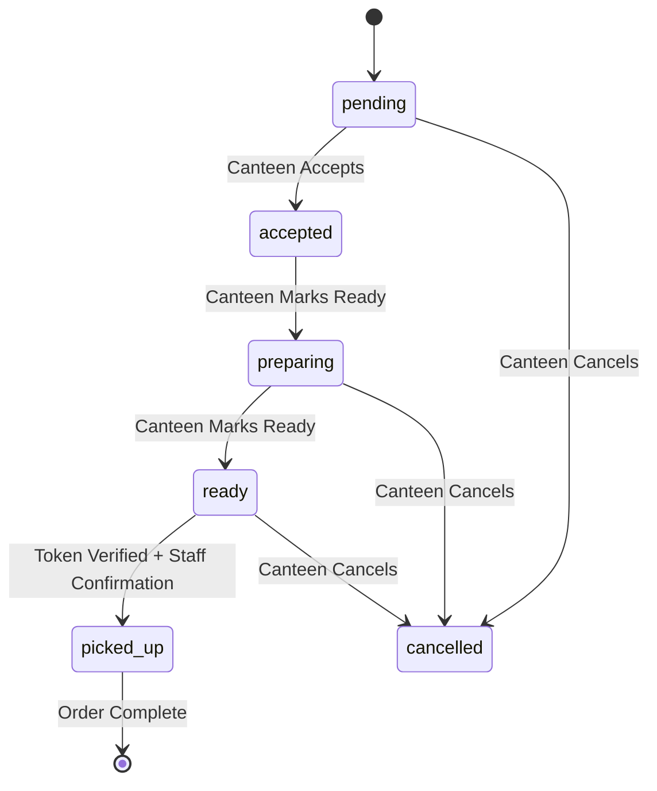

# SMEIC Working Flow Documentation

## Project Folder Structure

## User Roles and Permissions

## Login and Authentication Flow

## Complete User Journey for Each Role

### Canteen Staff Journey

### Admin Journey

## Menu Browsing, Cart, Checkout, and Payment/Wallet Flow

## Order Processing and Status Updates

## QR Code and Pickup Verification Flow

## Database Interactions and Relationships

## Notifications and Wallet Transactions

## Backend API and Frontend Communication

## Security and Access Control

## Complete Order Lifecycle with Flow Diagrams

## Configuration Reference (config/constants.php)

## Troubleshooting Guide (Common Issues)

| Symptom | Likely Cause | Recommended Fix |
|---------|--------------|-----------------|
| Login fails with "Invalid credentials" | Wrong student ID/email or password; seed hash state | Verify credentials; if first-time import, use seed hash reset from login page |
| Cart not updating after adding items | CSRF token expired (session timeout) | Reload the page; new CSRF token generated |
| Order status not updating | Canteen staff doesn't have `can_verify_tokens` permission | Admin must grant permission in staff management |
| Pickup token "invalid" | Token expired ( > TOKEN_EXPIRY_HOURS ) or wrong order status | Student re-views token page; generate new token if needed |
| Parent can't transfer funds | Insufficient parent wallet balance | Top up parent wallet first (admin top-up) |
| Notifications not appearing | User hasn't loaded the notifications page recently | Refresh page; `check-notifications` API polls unread count |
| CSV/PDF export missing data | Filter criteria too narrow (no orders in date range) | Clear filters or expand date range |
| Student sees "Low wallet balance" but parent just transferred | Cache delay or transaction not committed | Wait a moment; check transactions page for updated balance |
```
Key constants defined in the application (verified from `config/constants.php`):

| Constant | Typical Value | Usage |
|----------|---------------|-------|
| `CURRENCY` | `'₹'` (Indian Rupee) | Money formatting |
| `LOW_BALANCE_THRESHOLD` | e.g., `20.00` | Student dashboard low-balance warning |
| `TOKEN_EXPIRY_HOURS` | e.g., `24` | Pickup token expiry time |
| `TOKEN_VERIFY_MAX_ATTEMPTS` | e.g., `5` | Max token verification attempts per 15 min |
| Various page titles and labels | — | View rendering |
```
### Order Lifecycle State Diagram (Mermaid)



### Order Lifecycle Flow Description

1. **Order Creation (Student Checkout)**
   - Student cart → checkout → order created with `status='pending'`
   - Order number generated (unique)
   - Cart cleared
   - Student redirected to order-tracking page

2. **Canteen Accepts Order**
   - Canteen views pending orders
   - Clicks **Accept** → `status` changes to `'accepted'`
   - Optional prep time input

3. **Canteen Prepares Order**
   - Clicks **Mark Ready** → `status` changes to `'preparing'`
   - `prepared_time_minutes` recorded
   - Second **Mark Ready** → `status` changes to `'ready'`
   - `ready_at` timestamp set to NOW

4. **Order Ready for Pickup**
   - System generates 6-digit pickup token
   - Student notified (notification + badge)
   - Student views token via `student/token` page
   - Token displayed to canteen staff

5. **Pickup Verification**
   - Staff enters token in `canteen/scan.php`
   - System validates token matches `orders.pickup_token`
   - `status` → `'picked_up'`, `picked_up_at` = NOW
   - Order considered complete

6. **Cancellation (Any status)**
   - Clicks **Cancel** → `status` → `'cancelled'`, `cancelled_at` = NOW
   - Refund processed implicitly (pending orders only)

7. **Reminder Dispatch (Background)**
   - Periodic check: ready orders > 3 min → send reminder to student
   - Max 3 reminders; after that, manual intervention required
```
### Authentication Security
- **Password hashing:** All passwords stored as `password VARCHAR(255)` — bcrypt `$2y$10$` format (seed hash from `database.sql`)
- **Force password change:** On initial login, users with `force_password_change=1` are forced to change password via `change-password` action
- **Session fixation protection:** `session_regenerate_id(true)` on successful login
- **Session termination:** `logout()` clears session and deletes cookie

### Authorization (Role-Based Access Control)
- **`require_login()`** — checks `!empty($_SESSION['user_id'])`; if missing, redirects to `?action=login`
- **`require_role(['admin'])`** — checks `$_SESSION['role']` is in the allowed array; if not, redirects to login
- **Role-based routing:** `redirectByRole()` maps each role to its dashboard

### Input Validation and Sanitization
- **`e()` helper** — htmlspecialchars escape for all output to prevent XSS
- **Prepared statements** via PDO for all database queries (no raw SQL concatenation)
- **Input type constraints:** `pattern="\d{6}"` for token inputs, `inputmode="numeric"` for numeric fields
- **Quantity limits:** cart quantity capped at 20 in `update-cart.php`
- **Amount validation:** positive amounts only; insufficient balance throws exception

### SQL Injection Prevention
- All queries use PDO prepared statements with parameterized queries
- Example: `$pdo->prepare("SELECT * FROM users WHERE email = ?")->execute([$email])`
- No string concatenation in any SQL in the controllers/APIs

### CSRF Protection
- Token stored in `$_SESSION['csrf_token']` (generated in `_bootstrap.php` or login flow)
- Form helper `csrf_field()` outputs `<input type="hidden" name="csrf_token" value="<?= $_SESSION['csrf_token'] ?>">`
- `csrf_check()` compares `$_POST['csrf_token']` with `$_SESSION['csrf_token']`
- Token regenerated on login; mismatched token requires page reload
```
### API Base
- All APIs live under `public/api/`
- Each file starts with: `require_once __DIR__ . '/_bootstrap.php'`
- `_bootstrap.php` handles: `session_start()`, CSRF token validation, PDO `db()` connection, `json_response()` helper

### Standard API Response Format
```json
{"ok": true, "data": {...}}
```
or
```json
{"ok": false, "error": "description"}
```
HTTP status codes are also used (403 = unauthorized, 400 = bad request, 404 = not found).

### Key API Endpoints

| Endpoint | Auth | Purpose |
|----------|------|---------|
| `update-cart.php` | student only | Add/chANGE qty/remove from student cart |
| `transfer-funds.php` | parent only | Parent → student wallet transfer (AJAX) |
| `check-notifications.php` | any logged-in user | Get unread notification count + latest |
| `get-order-status.php` | student/parent/admin (scoped) | Get current status of a specific order ID |
| `check-pickup-reminders.php` | any logged-in user (idempotent) | Dispatch reminders for ready orders > 3 min |

### Frontend ↔ Backend Communication Patterns
- **HTML forms:** Submit to `index.php?action=canteen/accept-order` etc. (POST with CSRF field)
- **AJAX/cart update:** `fetch('public/api/update-cart.php', {method: 'POST', body: formData})` → update badge
- **Order status polling:** `setInterval(() => fetch('public/api/get-order-status.php?id=' + orderId), 15000)` — student order tracking polls every 15 sec
- **Token verification:** Form POST to `canteen/scan.php` — traditional form submit
- **All POST requests include:** `<?= csrf_field() ?>` hidden input

### CSRF Protection
- `csrf_check()` validates the CSRF token stored in session against the form-submitted token
- Token is generated per session and embedded in forms via `csrf_field()` helper
- All state-changing POST requests must include CSRF token; API endpoints also verify
```
### Notification System
- **Helper function:** `notify($userId, $userType, $title, $message)` — located in `AuthController`/`ParentController`
- **Implementation:**
  - Inserts into `notifications` table: `INSERT INTO notifications (user_id, user_type, title, message) VALUES (?, ?, ?, ?)`
  - Can also log to file (`LOG_PATH . 'mail.log'`) and attempt PHPMailer send (currently stubbed/log-only)
- **Per-user notification queries:**
  - Student: `SELECT * FROM notifications WHERE user_id=? AND user_type='student' ORDER BY id DESC LIMIT 100`
  - Parent: `SELECT * FROM notifications WHERE user_id=? AND user_type='parent' ORDER BY id DESC LIMIT 100`
  - Canteen: `SELECT * FROM notifications WHERE user_id=? AND user_type='canteen' ORDER BY id DESC LIMIT 100`
  - Admin: `SELECT * FROM notifications WHERE user_id=? AND user_type='admin' ORDER BY id DESC LIMIT 100`

- **Mark-as-read:** When a user views their notifications page, the system performs:
  ```sql
  UPDATE notifications SET is_read=1 WHERE user_id=? AND user_type='parent'
  ```
  (Similar for other user types)

- **check-notifications API:** Returns `unread count` + `latest notification` for the logged-in user

### Wallet Transaction Flow
Every money movement creates **two** transaction records:

| Scenario | Transaction 1 (user_type='parent') | Transaction 2 (user_type='student') |
|----------|-----------------------------------|-------------------------------------|
| Parent transfers funds to child | `amount` = debited, `type` = 'debit', `reference` = 'Transfer to student {name}', `balance_after` = new parent balance | `amount` = credited, `type` = 'credit', `reference` = 'Transfer from parent', `balance_after` = new student balance |
| Admin tops up parent wallet | `amount` = added, `type` = 'credit', `reference` = 'Wallet top-up by admin', `balance_after` = new parent balance | None (or system records as admin credit) |
| Admin tops up student wallet | None (or system records) | `amount` = credited, `type` = 'credit', `reference` = 'Wallet top-up by admin', `balance_after` = new student balance |

- **Transactions table query** (Admin view): `SELECT t.*, COALESCE(p.full_name, s.full_name) AS user_name FROM transactions t LEFT JOIN parents p ON p.id=t.user_id AND t.user_type='parent' LEFT JOIN students s ON s.id=t.user_id AND t.user_type='student' ORDER BY t.id DESC`
```
### Core Tables and Relationships

| Table | Key Columns | Foreign Keys | Description |
|-------|-------------|--------------|-------------|
| **users** | id, role, ref_id, email, password, force_password_change, is_active | ref_id → canteen_staff.id OR parents.id | Unified auth table for admin, parent, canteen |
| **canteen_staff** | id, full_name, email, phone, password, force_password_change | — | Canteen staff accounts |
| **parents** | id, parent_id, full_name, email, phone, address, wallet_balance, password, force_password_change | — | Parent accounts with wallet balance |
| **students** | id, student_id, full_name, class_name, roll_no, behavioral_score, parent_id, password, force_password_change, is_deleted | parent_id → parents.id ON DELETE SET NULL | Student accounts; soft-delete enabled |
| **student_parent_links** | id, student_id, parent_id, relationship | student_id → students.id ON DELETE CASCADE; parent_id → parents.id ON DELETE CASCADE | Explicit link table (for future multi-child support) |
| **wallets** | id, student_id, balance, updated_at | student_id → students.id ON DELETE CASCADE | Per-student wallet balance |
| **menu_items** | id, name, description, price, category, image, is_available | — | Menu items with availability |
| **daily_specials** | id, menu_item_id, special_date, expires_at, is_active, created_by | menu_item_id → menu_items.id ON DELETE CASCADE | Daily specials |
| **carts** | id, student_id, menu_item_id, quantity, added_at | student_id → students.id ON DELETE CASCADE; menu_item_id → menu_items.id ON DELETE CASCADE | Student shopping cart |
| **orders** | id, student_id, order_number, total_amount, status, prepared_time_minutes, ready_at, picked_up_at, cancelled_at, pickup_token, pickup_reminder_count, created_at, updated_at | student_id → students.id ON DELETE CASCADE | Customer orders |
| **order_items** | id, order_id, menu_item_id, quantity, price | order_id → orders.id ON DELETE CASCADE; menu_item_id → menu_items.id ON DELETE RESTRICT | Line items per order |
| **transactions** | id, user_id, user_type, amount, type, reference, balance_after, created_at | — | Wallet transaction ledger (parent debit / student credit) |
| **notifications** | id, user_id, user_type, title, message, is_read, created_at | — | In-system notifications per user type |
| **feedback** | id, student_id, order_id, rating, comment | student_id → students.id ON DELETE CASCADE; order_id → orders.id ON DELETE SET NULL | Student feedback on orders |
| **password_resets** | id, email, token, expires_at | — | Password reset token storage |
| **audit_logs** | id, admin_id, action, details, created_at | admin_id → users.id | Audit trail of admin actions |
| **parent_preferences** | id, parent_id, menu_item_id, preference_date, note, is_seen | parent_id → parents.id ON DELETE CASCADE; menu_item_id → menu_items.id ON DELETE CASCADE | Parent suggests items to child |

### ER Diagram Summary
- **users** 1:N **canteen_staff** / **parents** (via ref_id)
- **parents** 1:N **students** (via parent_id, SET NULL on delete)
- **students** 1:N **wallets** (via student_id, CASCADE on delete)
- **students** 1:N **orders** (via student_id, CASCADE on delete)
- **orders** 1:N **order_items** (via order_id, CASCADE on delete)
- **orders** 1:N **transactions** (via user_id + user_type — not formal FK but application-enforced)
- **menu_items** 1:N **carts** (via menu_item_id, CASCADE on delete)
- **menu_items** 1:N **order_items** (via menu_item_id, RESTRICT on delete)
- **menu_items** 1:N **daily_specials** (via menu_item_id, CASCADE on delete)
- **parents** 1:N **parent_preferences** (via parent_id, CASCADE on delete)
- **parents** 1:N **transactions** (as user_type='parent')
- **students** 1:N **transactions** (as user_type='student')
- **admins** 1:N **audit_logs** (via admin_id)

### Key Queries Used Throughout the App
- **Login authenticate:** `SELECT * FROM {table} WHERE email=? OR student_id=? LIMIT 1` + password_verify()
- **Get student balance:** `SELECT balance FROM wallets WHERE student_id = ?` (helper function `get_student_balance()`)
- **Get active special:** `SELECT * FROM daily_specials WHERE is_active=1 AND special_date=CURDATE() LIMIT 1`
- **Cart count:** `SELECT COALESCE(SUM(quantity),0) FROM carts WHERE student_id = ?`
- **Order status by ID:** `SELECT * FROM orders WHERE id=? AND student_id=?` (student-scoped) or without student_id (canteen/admin)
- **Unread notifications:** `SELECT COUNT(*) FROM notifications WHERE user_id=? AND user_type=? AND is_read=0`
- **Recent transactions:** `SELECT t.*, COALESCE(p.full_name, s.full_name) AS user_name FROM transactions t LEFT JOIN parents p ON p.id=t.user_id AND t.user_type='parent' LEFT JOIN students s ON s.id=t.user_id AND t.user_type='student' ORDER BY t.id DESC LIMIT 10`
```
### QR Token Generation
- When an order reaches `status='ready'`, the system generates a **6-digit numeric pickup token**
- Token is stored in `orders.pickup_token` (VARCHAR(40))
- Token expiry: `TOKEN_EXPIRY_HOURS` (configured in `config/constants.php`, typically 24 hours)
- Rate limit: `TOKEN_VERIFY_MAX_ATTEMPTS` (e.g., 5 attempts per 15 minutes) — enforced in the verification API

### Student Views Their Token
- **URL:** `index.php?action=student/token`
- Page shows: 6-digit code in a large display, expiry time, rate-limit info
- Underlying: no API call needed — token is already in the session/order; page just displays it

### Canteen Verifies Token (Pickup)
1. Student shows 6-digit token to canteen staff
2. Staff navigates to `index.php?action=canteen/scan`
3. Staff enters the 6-digit token in the form
4. On POST:
   - Validates `pattern="\d{6}"` (6 digits only)
   - Looks up `orders` by `id` (or the system associates the current order context)
   - **Verification logic:** `SELECT * FROM orders WHERE id=? AND pickup_token=?`
   - If match: `UPDATE orders SET status='picked_up', picked_up_at=NOW() WHERE id=?`
   - If no match: error message "Invalid token or order not ready"
5. On success: order status changes to `picked_up`, `picked_up_at` is timestamped
6. Student can refresh order tracking to see the update

### Pickup Reminder Dispatcher
- **API:** `public/api/check-pickup-reminders.php`
- **Purpose:** Idempotent dispatcher — runs periodically (e.g., via cron or scheduled task)
- **Logic:** `dispatch_pickup_reminders()` — finds orders where `status='ready'` AND `ready_at < NOW() - 3 minutes` AND `pickup_reminder_count < 3`
- For each such order: increments `pickup_reminder_count`, sends notification to the student via `notify()`
- If already sent 3 reminders, stops sending (order may need manual intervention)

### Rate Limiting (Anti-Abuse)
- Token verification max attempts: configured per `config/constants.php`
- Implementation: tracks attempts in session or a separate table (details in the API code)
- After max attempts, further verification requires waiting or re-requesting token
```
### Order Lifecycle States
```
pending → accepted → preparing → ready → picked_up
                         ↘
                         cancelled
```

### Status Transition Triggers

| From → To | Trigger | Who Can Act | Internal Action |
|-----------|---------|-------------|-----------------|
| pending → accepted | **Accept** button | Canteen staff | `UPDATE orders SET status='accepted' WHERE id=?` |
| accepted → preparing | **Mark Ready** button | Canteen staff | `UPDATE orders SET status='preparing', prepared_time_minutes=?, ready_at=NOW() WHERE id=?` |
| preparing → ready | **Mark Ready** (second click or auto) | Canteen staff | `UPDATE orders SET status='ready' WHERE id=?` |
| ready → picked_up | **Token Verification** | Canteen staff (via scan.php) | `UPDATE orders SET status='picked_up', picked_up_at=NOW() WHERE id=? AND pickup_token=?` |
| any → cancelled | **Cancel** button | Canteen staff (or admin) | `UPDATE orders SET status='cancelled', cancelled_at=NOW() WHERE id=?` |

### Canteen Order Management (per-order UI)
Each order card in `views/canteen/orders.php` shows action buttons based on current status:
- **pending:** Accept (with prep time input), Cancel
- **accepted/preparing:** Mark Ready
- **ready:** Mark Picked Up (shows 6-digit token), Cancel
- **picked_up/cancelled:** no action buttons

Live polling: `setTimeout(() => location.reload(), 20000)` on the orders page reloads every 20 seconds to fetch new orders.
```
### Menu Browsing
- **URL:** `index.php?action=student/menu` (student) or `index.php?action=canteen/menu` (canteen)
- **Query:** `SELECT * FROM menu_items WHERE is_available=1 ORDER BY name`
- **Filters:** Category ENUM filter (veg, nonveg, snacks, drinks, desserts)
- **Daily Specials:** `daily_specials` table — active specials shown with date expiry

### Cart Flow
- **Add to cart:** `public/api/update-cart.php`
  - Auth check: `($_SESSION['role'] ?? '') !== 'student'` → 403 if not student
  - CSRF check: `!csrf_check()` → 400
  - Input: `item_id` + `quantity` (JSON or form-encoded)
  - **Availability check:** `SELECT id, is_available, name, price FROM menu_items WHERE id = ?` — if `is_available` ≠ 1, return error
  - **Upsert:** `INSERT INTO carts ... ON DUPLICATE KEY UPDATE quantity = VALUES(quantity)` — unique constraint on (student_id, menu_item_id)
  - **Cart count:** `SELECT COALESCE(SUM(quantity),0) FROM carts WHERE student_id = ?` — returned for badge update

- **Remove from cart:** `quantity <= 0` in the API → `DELETE FROM carts WHERE student_id=? AND menu_item_id=?`

- **View cart:** `views/student/cart.php` — renders cart items with remove buttons; each change calls the API

### Checkout Flow
1. Student clicks **Checkout** on cart page
2. `StudentController::checkout()`:
   - Fetches all cart items for the student
   - Computes `total_amount = SUM(oi.quantity * oi.price)` from cart + menu price
   - **Creates order:** `INSERT INTO orders (student_id, order_number, total_amount, status) VALUES (?, generated_number, ?, 'pending')`
   - **Creates order_items:** for each cart item, `INSERT INTO order_items (order_id, menu_item_id, quantity, price)`
   - **Clears cart:** `DELETE FROM carts WHERE student_id = ?`
   - **Generates order_number:** `ORDER-YYYYMMDD-XXXX` format (based on last order number)
   - Redirects to `order-tracking` page with the new order ID

### Payment / Wallet Flow
- **No direct student payment** — students order; parents fund the wallet
- **Parent → Student transfer:**
  - `transfer-funds.php` API (or parent form):
    - Auth: parent role only
    - CSRF validation
    - Validates child belongs to parent (JOIN students + parent_id check)
    - Checks `parents.wallet_balance >= amount`
    - `UPDATE parents SET wallet_balance = wallet_balance - amount WHERE id = ?`
    - `UPDATE wallets SET balance = balance + amount WHERE student_id = ?`
    - `INSERT INTO transactions` — parent debit + student credit (both with `balance_after`)
    - `notify(student, 'Funds Received', 'Your parent transferred {amount}.')`
    - Returns new balances to client

- **Admin top-up:**
  - `AdminController::topup()` — target = parent or student
  - If parent: `UPDATE parents SET wallet_balance = wallet_balance + amount`
  - If student: `UPDATE wallets SET balance = balance + amount`
  - `INSERT INTO transactions` with type='credit', reference='Wallet top-up by admin'
  - Returns success
```
| Step | User Action | Internal System Response |
|------|-------------|--------------------------|
| 1 | Logs in as admin → **Admin Dashboard** | `AdminController::dashboard()` — counts total students, orders today, revenue (all-time + month), weekly orders chart, monthly revenue trend chart, recent transactions table with charts |
| 2 | Exports reports (CSV/PDF) | `AdminController::exportReport()` — `?action=admin/export&kind=orders|transactions&format=csv|pdf`; generates data, invokes `exportPdf()` or sets CSV headers |
| 3 | Manages students → add, edit, reset password, delete | `AdminController::students()` — CRUD on `students` table; parent selector from existing parents; password reset triggers `force_password_change` flag |
| 4 | Manages parents → add, edit, top up wallet | `AdminController::topup()` — two targets: parent wallet or student wallet; deducts from admin context or parent's `wallet_balance`; records transaction |
| 5 | Views **All Orders** → filters by student, date, status | `AdminController::orders()` — broad `orders` query with optional `from/to` dates, status, student filters; CSV/PDF export |
| 6 | Views **All Transactions** → system-wide wallet activity | `AdminController::transactions()` — queries `transactions` table with filters by type, user_type, date range; export supported |
| 7 | Views/Manages staff | `AdminController::staff()` — manages `canteen_staff` table; protected row (id=1, Manager) cannot be deleted/toggled |
| 8 | Views behavioral scores & audit logs | Dashboard KPI includes behavioral score; admin can view detailed records |
```
| Step | User Action | Internal System Response |
|------|-------------|--------------------------|
| 1 | Logs in as canteen staff → **Canteen Dashboard** | `CanteenController::dashboard()` — counts orders by status, revenue totals, recent transactions; renders KPI cards |
| 2 | Views **Order Management** → filters by status | `CanteenController::orders()` — fetches all orders with optional status filter; renders table with accept/mark-ready/mark-picked up/cancel buttons per status |
| 3 | Accepts a pending order | POST to `canteen/accept-order` — updates `orders.status` = 'accepted', optionally sets `prepared_time_minutes`; redirects back |
| 4 | Marks order as **Ready** | POST to `canteen/mark-ready` — updates `orders.status` = 'ready', sets `ready_at` = NOW; redirects |
| 5 | Marks order as **Picked Up** | Two ways:<br>• Staff enters 6-digit token in `canteen/scan.php` → verifies token against `orders.pickup_token`, updates status = 'picked_up', sets `picked_up_at` = NOW<br>• Staff uses token verification API |
| 6 | Cancels an order | POST to `canteen/cancel-order` — updates `orders.status` = 'cancelled', sets `cancelled_at` = NOW; refund logic implicit (order was pending) |
| 7 | Views **Staff Management** → adds/edits/toggles staff permissions | `CanteenController::staff()` — CRUD on `canteen_staff` table; permission checkboxes: `can_verify_tokens`, `can_complete_orders`, `can_view_pending_orders` |
| 8 | Views **Earnings** → revenue reports | `CanteenController::earnings()` — sums `total_amount` from orders with status in ('picked_up','ready','preparing','accepted') |
```
### Student Journey

| Step | User Action | Internal System Response |
|------|-------------|--------------------------|
| 1 | Opens `index.php?role=student` → clicks **Login** → selects Student role | Login form displays with Student role pre-selected |
| 2 | Enters student ID (or email) and password, clicks **Login** | `AuthController::login()` authenticates against `students` table; session variables set; redirects to `student/dashboard` |
| 3 | **Browse Menu** → views available items with prices, categories, availability | `StudentController::menu()` — queries `menu_items WHERE is_available=1`; renders menu with category filters |
| 4 | Clicks **Add to Cart** on an item | `public/api/update-cart.php` — checks `is_available`, upserts into `carts` table (student_id + menu_item_id + quantity); returns new `cart_count` for badge update |
| 5 | Clicks **Cart** → reviews items, adjusts quantities or removes items | Views `cart.php` — shows cart items with remove buttons; each change calls `update-cart.php` |
| 6 | Clicks **Checkout** | `StudentController::checkout()` — computes total from cart, creates order in `orders` table (status='pending'), populates `order_items`, clears cart, redirects to `order-tracking` |
| 7 | Views **Order Tracking** — sees status timeline (Pending → Accepted → Preparing → Ready → Picked Up) | `student/order-tracking.php` — polls `get-order-status.php` via live update; status badge and timeline progress |
| 8 | Receives **Notification** when order is ready | `check-notifications.php` — returns unread count + latest notification; `notifications.php` marks them as read on view |
| 9 | Views **My Token** — sees 6-digit QR code / token for pickup | `StudentController::token()` — generates/dispatches 6-digit pickup token; stores in `orders.pickup_token`; displays with expiry info |
| 10 | Shows token to canteen staff → staff verifies → order marked picked up | Canteen enters token in `scan.php` → `canteen/verify-token` logic → `orders.status` = 'picked_up', `picked_up_at` = NOW |

### Parent Journey

| Step | User Action | Internal System Response |
|------|-------------|--------------------------|
| 1 | Logs in as parent → **Parent Dashboard** | `ParentController::dashboard()` — loads parent profile, fetches children via `getChildren()`, computes spend-by-category, shows recent orders, behavioral scores, active daily special |
| 2 | Transfers funds to child's wallet | `ParentController::transfer()` — form to select child + amount; on POST: validates CSRF, checks parent wallet balance (`parents.wallet_balance`), deducts from parent, adds to student wallet (`wallets.balance`), creates two `transactions` rows (parent: debit, student: credit), sends notification via `notify()`, commits transaction |
| 3 | Views **Child Orders** → selects a child + date range | `ParentController::childOrders()` — filters `orders WHERE student_id AND DATE BETWEEN ...`; renders order list |
| 4 | Views **Order Detail** → sees items, total, status | `ParentController::orderDetail()` — verifies child belongs to this parent (JOIN students + parent_id check); renders order with order_items + menu names |
| 5 | Sets **Meal Preferences** → suggests items to child | `ParentController::preferences()` — form with menu items; on POST: inserts into `parent_preferences` (parent_id + menu_item_id + note); shows "Suggestion sent" message |
| 6 | Views **Transactions** → wallet activity history | `ParentController::notifications()` — queries `notifications WHERE user_id + user_type='parent'`; marks as read; renders table |
| 7 | Views **Profile** → updates personal info | `ParentController::profile()` — simple profile display |
```
### Step-by-Step: What the User Does + What Happens Internally

1. **User navigates to `index.php?role=student`** (or selects a role on the login page)
   - User sees the login form with role selector and credential fields

2. **User enters credentials and submits**
   - Browser sends `POST` to `index.php?action=auth/login`

3. **Server-side validation (AuthController::login)**
   - **CSRF check:** `csrf_check()` — if invalid, error "Invalid CSRF token. Please reload the page."
   - **Role validation:** role must be one of `['admin', 'student', 'parent', 'canteen']`
   - **Credential check:** identifier (email/username) and password are not empty
   - **Authenticate:** `authenticate($role, $identifier, $password)` — queries the appropriate table:
     - **Student:** queries `students` table by `student_id`, verifies password from `students.password`
     - **Parent:** queries `parents` table by email, verifies password from `parents.password`
     - **Canteen:** queries `canteen_staff` table by email, verifies password from `canteen_staff.password`
     - **Admin:** queries `users` table by email, where `role='admin'`
   - **On success:**
     - `session_regenerate_id(true)` — session fixation protection
     - Store in `$_SESSION`: `user_id`, `role`, `name`, `username`, `force_change`
     - If `$user['force_change'] === 1`: flash info "Please change your temporary password to continue" → redirect to `change-password`
     - If `$user['force_change'] === 0`: flash success "Welcome back, {name}!" → `redirectByRole($user['role'])`
   - **On failure:** flash error "Invalid login credentials." → redisplay login page

4. **Role-Specific Redirect (redirectByRole)**
   - `admin` → `index.php?action=admin/dashboard`
   - `student` → `index.php?action=student/dashboard`
   - `parent` → `index.php?action=parent/dashboard`
   - `canteen` → `index.php?action=canteen/dashboard`

5. **Subsequent requests**
   - Every page starts with `session_start()`
   - `require_login()` — if `$_SESSION['user_id']` is empty, redirect to login
   - `require_role(['admin'])` — if role doesn't match, redirect to login

### Password Reset Flow (Seed Hash Detection)
- On login, `AuthController::isSeedHashState()` checks if the admin/parent/student password hash starts with the known seed pattern `$2y$10$5nZ1RkjA3L`
- If it's the seed state, a flag `$needsHashReset` is set and displayed on the login page offering a one-click fix
- This applies to the initial database import state only

### Logout Flow
- `AuthController::logout()`:
  - Clears `$_SESSION = []`
  - Deletes the session cookie via `setcookie(session_name(), '', time() - 42000, ...)`
  - Redirects to login page
```
| Role             | Capabilities                                                                                                                 |
|------------------|------------------------------------------------------------------------------------------------------------------------------|
| **Admin**        | Full system access: manage students, parents, canteen staff, view all orders/transactions, export CSV/PDF reports, view earnings |
| **Student**      | Browse menu, add items to cart, place orders, view order history/status, check wallet balance, receive notifications, view QR token for pickup |
| **Parent**       | Top up student wallet(s), view children's orders and spending, set meal preferences, receive notifications, view transaction history |
| **Canteen Staff**| Accept orders, mark orders as preparing/ready, verify pickup tokens, view pending/accepted orders, manage staff permissions (verify tokens, complete orders) |

### Per-Role Permission Matrix

| Feature                              | Admin | Student | Parent | Canteen |
|--------------------------------------|:------:|:-------:|:------:|:------:|
| Browse menu                          |   ✓    |   ✓     |   ✓    |   ✓    |
| Add to cart / checkout               |   —    |   ✓     |   —    |   —    |
| Place order                          |   —    |   ✓     |   —    |   —    |
| View own orders                      |   —    |   ✓     |   ✓    |   —    |
| View all orders                      |   ✓    |   —     |   —    |   —    |
| Accept/reject orders                 |   —    |   —     |   —    |   ✓    |
| Mark order preparing/ready            |   —    |   —     |   —    |   ✓    |
| Mark order picked up                 |   —    |   —     |   —    |   ✓    |
| Verify pickup token                  |   —    |   —     |   —    |   ✓    |
| Top up wallet (parent → student)     |   —    |   —     |   ✓    |   —    |
| View own transactions                |   —    |   ✓     |   ✓    |   —    |
| View all transactions                |   ✓    |   —     |   —    |   —    |
| Manage students                      |   ✓    |   —     |   —    |   —    |
| Manage parents                       |   ✓    |   —     |   —    |   —    |
| Manage staff                         |   ✓    |   —     |   —    |   —    |
| Export reports (CSV/PDF)             |   ✓    |   —     |   —    |   —    |
| View dashboard KPIs                  |   ✓    |   ✓     |   ✓    |   ✓    |
```
```
SMEIC/
├── config/                   # PHP configuration files
│   ├── constants.php         # Currency, thresholds, token settings
│   ├── database.php          # PDO database connection
│   └── functions.php         # Helper functions (csrf_check, url, e, render_with_layout, etc.)
├── controllers/              # PHP controllers (MVC pattern)
│   ├── AuthController.php    # Login/logout/password reset
│   ├── StudentController.php # Student-facing actions
│   ├── CanteenController.php # Canteen staff actions
│   ├── AdminController.php   # Admin dashboard + reports + exports
│   └── ParentController.php  # Parent dashboard + transfers + preferences
├── public/                   # Document root (Web root)
│   ├── index.php             # Front controller / router
│   ├── _bootstrap.php        # Shared API bootstrap (session, CSRF, db)
│   ├── api/                  # JSON API endpoints
│   │   ├── update-cart.php
│   │   ├── transfer-funds.php
│   │   ├── check-notifications.php
│   │   ├── get-order-status.php
│   │   └── check-pickup-reminders.php
│   ├── assets/
│   │   ├── css/style.css
│   │   └── js/app.js
│   └── views/                # PHP templates (TwinTailwind CSS)
│       ├── layouts/          # Shared layout components
│       │   ├── header.php
│       │   ├── sidebar.php
│       │   └── footer.php
│       ├── auth/             # Authentication pages
│       │   └── login.php
│       ├── student/          # Student dashboard & related
│       │   ├── dashboard.php
│       │   ├── menu.php
│       │   ├── cart.php
│       │   ├── checkout.php
│       │   ├── order-tracking.php
│       │   ├── orders.php
│       │   ├── profile.php
│       │   ├── notifications.php
│       │   ├── token.php
│       │   └── qr.php
│       ├── canteen/          # Canteen staff interface
│       │   ├── dashboard.php
│       │   ├── staff.php
│       │   ├── menu.php
│       │   ├── daily-special.php
│       │   ├── orders.php
│       │   └── scan.php
│       ├── parent/           # Parent interface
│       │   ├── dashboard.php
│       │   ├── preferences.php
│       │   ├── child-orders.php
│       │   └── order-detail.php
│       └── admin/            # Admin interface
│           ├── dashboard.php
│           ├── students.php
│           ├── parents.php
│           ├── orders.php
│           ├── topup.php
│           └── transactions.php
└── database.sql              # Schema + seed data (MySQL)
```
## Project Overview and Architecture

**SMEIC** (School Management for Educational Institution Canteen) is a University Canteen Management System built with PHP, MySQL, JavaScript, and Tailwind CSS. The application follows a **PHP MVC-lite** architecture with a single front controller that routes all requests.

### Architecture Pattern
- **Front Controller:** `public/index.php` — all requests are routed through this single entry point
- **Routing:** `?action=controller/method` pattern is used throughout the application
- **MVC Structure:** Controllers handle business logic, Views render HTML, Config/Database handle data
- **Template Engine:** PHP views with embedded PHP; layout consists of header, sidebar, and footer
- **Styling:** Tailwind CSS via CDN; custom CSS in `public/assets/css/style.css`
- **JavaScript:** Vanilla JS with Alpine.js for interactivity; `public/assets/js/app.js`

### Request Flow
1. User accesses `index.php` with `?action=role/dashboard` query parameter
2. `public/index.php` parses the action and instantiates the appropriate controller
3. Controller checks authentication (`require_login()`, `require_role()`)
4. Controller fetches data from the database via PDO
5. Controller renders the appropriate view with data context
6. View returns HTML rendered within the shared layout (header/sidebar/footer)

---
